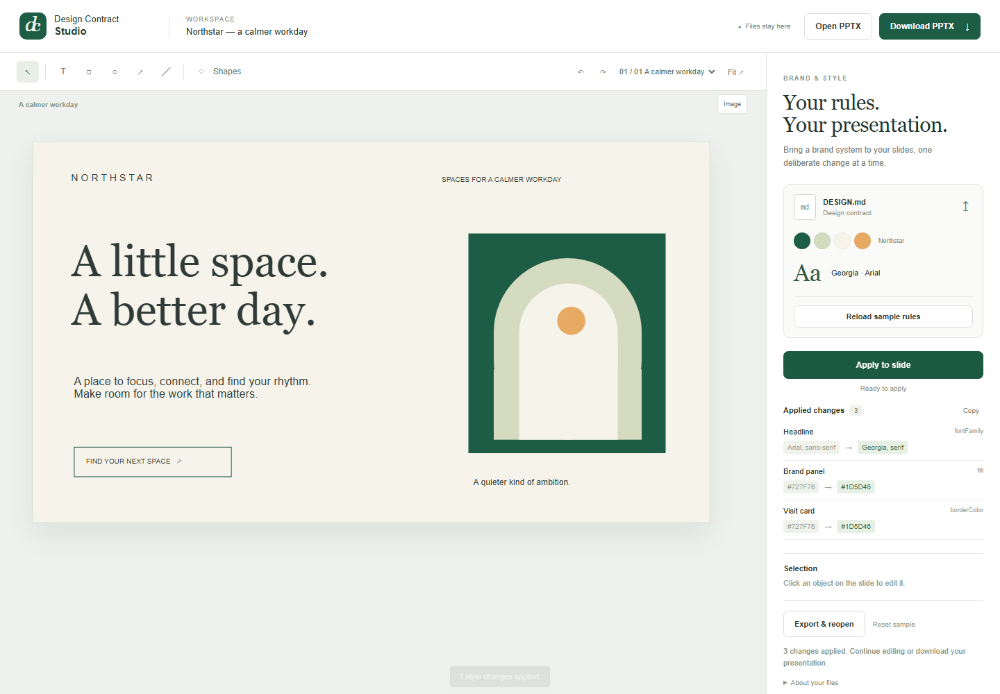

# Design Contract Studio

**Bring your brand rules to an editable presentation.**

[Open the studio](https://shinjaehyun20.github.io/design-contract-studio/)



Select and edit objects on a real slide. Load a `DESIGN.md` brand contract, see the property changes, and apply them to the current slide or selection. Download the result as a PowerPoint file that still contains editable text, shapes and pictures.

## Try it

1. Open the studio in a current desktop browser. File tools load automatically.
2. Choose **Load sample rules**. Loading leaves the slide unchanged.
3. Choose **Apply to slide**. The sample changes its heading font, accent panel and outlined action.
4. Click an object and use **Selection**, or double-click text to edit it. Use **Undo** to reverse edits.
5. Choose **Download PPTX**, or **Export & reopen** to continue from the exported file.

Use **Open PPTX** for your own presentation. Upload your own `DESIGN.md` using the arrow on the brand card. Save a project JSON from **About your files** to preserve the full editing state, and drag that JSON onto the canvas to restore it.

The Northstar presentation is an original fictional sample. It contains no client information or claimed business results.

## What runs where

Editing and PowerPoint conversion run in the browser, with the file adapter isolated in a Web Worker. No document is uploaded to an application server. Pyodide and Python packages download on first use, so an internet connection is needed to initialize file tools. A desktop browser gives the best editing experience; the interface also adapts to narrow screens.

This release has no model API calls, API key requirement, account or paid service. The original editor and Showcase flow were developed and reviewed with Codex. ChatGPT assisted the public browser edition, including the file worker, focused interface and PowerPoint fidelity fixes.

## Supported scope

- Editable text, basic PowerPoint shapes and embedded images.
- Color, font, size, position and selection editing.
- Heading/body font rules and explicitly targeted accent styling from `DESIGN.md`.
- A before/after property list and a source-linked change record.
- PowerPoint export and reopening with content and geometry checks.
- Up to 25 MB for an imported file and 100 slides for export.

The editor is a focused presentation tool. Complex charts, animations, text with multiple run-level styles, master/layout relationships and arbitrary vector paths are not preserved in full. Review these elements in PowerPoint before delivery. Export/reopen keeps the current document open if its checked content or geometry changes. This is not a complete PowerPoint compatibility checker.

Changes live in the current browser session. Download a PPTX or project JSON before closing or reloading the page.

## Run locally

```sh
python -m http.server 8080
```

Then open `http://localhost:8080`. The browser still downloads its file tools on first use. This is a static application; no Python application server or API credentials are needed.

The native adapter tests can be run separately:

```sh
python -m pip install -r requirements.txt
python -m unittest test_adapter -v
```

## Implementation

The existing JavaScript canvas and 33 Python parsing/conversion functions from Design Canvas Studio were reused. The public edition adds an isolated browser worker, a focused interface, previewed brand changes, preservation of native shape kinds, transparent fills, line widths, text spacing, slide titles and notes. File tests cover native editable shapes, Korean text, embedded images, malformed design input and empty presentations.

Browser dependencies: [Pyodide](https://pyodide.org/), [python-pptx](https://python-pptx.readthedocs.io/), PyYAML, defusedxml and their dependencies. Each retains its own license.

## Author

Jaehyun Shin. Copyright © 2026. All rights reserved for the application code and original sample artwork unless stated otherwise. Third-party dependencies are governed by their respective licenses.
